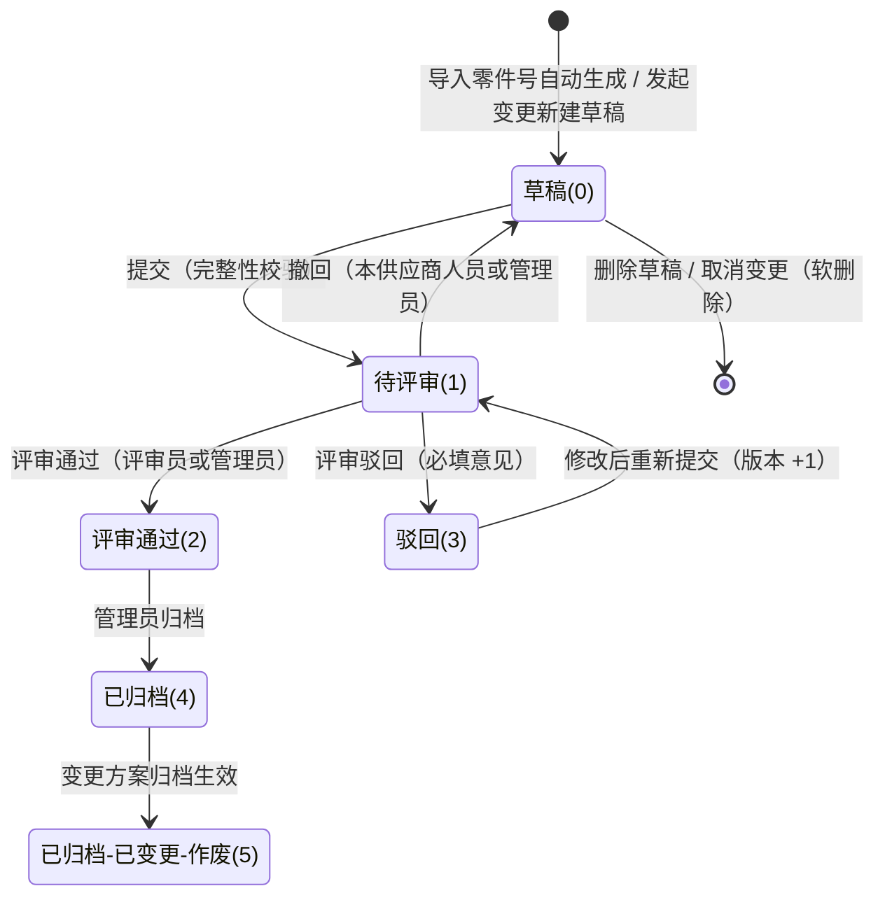

<p align="center">
  <a href="https://www.servbay.com" target="_blank" rel="noreferrer">
    
  </a>
</p>
> 本系统基于 [ServBay](https://www.servbay.com) 环境构建运行。

# PackSubmit 包装方案提交评审系统

> 面向汽车零部件供应链的「包装确认单」在线填报、评审、归档与变更管理系统。
>


---

## 一、项目介绍

供应商每供一个零件，都需要向客户提交一份**包装确认单**（包装方式、包装箱、托盘、图片、操作说明等）。传统方式靠邮件和 Excel 往返，容易出现版本混乱、零件号超出范围、资料填写不全、归档后无法追溯变更等问题。

PackSubmit 把这条链路搬到线上：

- **受控建单**：管理员导入「供应商 + 零件号」清单后，系统自动为对应供应商生成方案草稿，供应商不再手动新建方案，保证「同供应商同零件只有一种有效方案」。
- **在线填报**：客户 / 供应商资料从档案自动带出，零件名称 / 项目名称从零件号清单自动带出，托盘数量自动计算，四类包装图片在线管理。
- **严格评审**：提交前做完整性校验，评审员通过 / 驳回，管理员归档。
- **变更管理**：已归档方案可以发起变更，新旧两版并存；新版本归档生效后，旧版本自动标记为「已归档-已变更-作废」。
- **全程留痕**：方案查看 / 导出 / 状态流转、附件、登录、用户 / 字典 / 客户 / 供应商 / 零件号维护都有审计日志；客户、供应商、用户、零件号还提供页面内可查的维护日志。
- **标准导出**：按既有 A4 包装确认单模板导出 Excel，图片自动嵌入。
- **供应商联系人**：一个供应商可维护多个联系人（电话 / 邮箱 / 传真），供应商自助增删改，方案表单下拉选择自动带出。
- **供应商内互通**：同一供应商的不同账号视为一个整体，可互相查看 / 编辑 / 提交 / 撤回本供应商的方案，共享并共同维护联系人，不再局限于「只能操作本人创建的数据」。
- **只读查看者**：新增内部「查看者」角色，可查看全部状态的方案（含草稿）并导出，但不能修改任何信息、不能评审 / 归档，也不能维护供应商联系人。
- **高效填报**：编辑页可「复制其他方案」一键套用相似零件的包装信息（保留零件号 / 零件名称 / 项目车型与供应商资料）。
- **图片去重**：附件按文件内容 MD5 去重，同内容图片在服务器只保留一份，删除采用引用计数。
- **明细导出**：管理员可进入「全量详细方案」按多条件筛选，导出 52 个字段的明细 Excel。

---

## 二、技术栈

| 层次 | 技术 |
| --- | --- |
| 后端框架 | PHP >= 8.0、ThinkPHP 8、think-orm |
| 鉴权 | `thans/tp-jwt-auth`（JWT + 黑名单） |
| Excel / PDF | PhpSpreadsheet、Dompdf（PDF 路由当前暂停） |
| 数据库 | MySQL（utf8mb4，表前缀 `pf_`） |
| 前端 | Vue 3、Vite 6、Element Plus、Pinia、Vue Router、Axios |
| 部署 | Web 根目录指向 `public/`；前端构建产物输出到 `public/` |

---

## 三、系统架构与目录结构

前后端分离：前端 SPA 通过 `/api` 访问后端，统一使用 `Authorization: Bearer {token}`。

```
app/
├── controller/            # API 控制器
│   ├── Auth.php           # 登录 / 退出 / 改密 / 当前用户
│   ├── Proposal.php       # 方案列表、详情、提交、撤回、评审、导出、统计
│   ├── Attachment.php     # 附件上传 / 下载 / 预览 / 删除 / 绑定
│   ├── Dict.php           # 字典读取
│   ├── MasterData.php     # 客户 / 供应商 / 零件号读取
│   ├── SupplierContact.php # 供应商联系人（供应商自助维护）
│   └── admin/             # 管理员接口（User/Dict/Customer/Supplier/SupplierPart/Proposal/Log）
├── service/
│   ├── ProposalService.php    # 方案业务核心（状态机、校验、变更、归档、附件复制）
│   ├── PackExportService.php  # 包装确认单 Excel / PDF 生成
│   ├── AuditService.php       # 全局审计日志（pf_review_log）
│   └── MasterLogService.php   # 主数据维护日志（pf_master_log）
├── model/                 # 11 张表的模型
├── validate/              # 参数验证器
├── middleware/            # JwtAuth、RoleAuth
route/api.php              # 全部 API 路由
database/                  # 数据库初始化脚本（pack_submit.sql）
public/                    # 入口、附件、前端构建产物
frontend/                  # Vue 3 源码（npm run deploy 输出到 public/）
```

请求链路：

```
Vue 页面 → axios（Bearer Token）→ JwtAuth → RoleAuth(admin) → Controller
        → Service（事务 / 业务校验）→ Model → MySQL
        → 统一响应 { code, msg, data }
```

响应约定：`code = 1` 成功；`code = 0` 业务错误；`401` 未登录 / 登录失效；`403` 权限不足。

---

## 四、角色与权限

| 角色 | role | 数据范围 | 主要能力 |
| --- | --- | --- | --- |
| 供应商 | 1 | 本供应商全部方案 | 查看 / 编辑 / 提交 / 撤回本供应商的方案（供应商内互通）；发起变更；删除变更草稿；维护本供应商联系人；导出 |
| 评审员 | 2 | 所有非草稿方案 | 查看、评审；不能编辑、上传附件、新建、发起变更、维护联系人 |
| 管理员 | 3 | 全部数据 | 用户 / 字典 / 客户 / 供应商 / 零件号维护；全量方案、批量归档；评审（含自评审）、代编辑、代提交 / 代撤回；代维护供应商联系人；导出 |
| 查看者 | 4 | 全部方案（含草稿） | 只读：查看所有状态方案、导出；不能新增 / 编辑 / 提交 / 撤回 / 删除 / 变更，不能评审 / 归档，不能维护供应商联系人；可自助修改密码 |

权限落点：

- **前端**：路由守卫 + 管理员动态路由 + 按钮级 `permissions`；仅用于体验，不作为安全边界。
- **后端**：`JwtAuth` 校验 token 并回查用户状态；`admin` 路由组强制 `role=3`；业务层再做 `assertViewable` / `assertEditable` / 供应商归属校验。
- **列表范围**：供应商 `supplier = 本供应商名称`（供应商内互通）；评审员 `status <> 草稿`；查看者不过滤（含草稿）；管理员不过滤。

---

## 五、功能模块与详细流程

### 5.1 登录、退出、修改密码

**登录**

1. 校验账号、密码（bcrypt）。
2. 校验账号状态，禁用账号直接拒绝。
3. 签发 JWT（`uid`、`role`，默认 2 小时有效）。
4. 写入登录审计日志，返回 token 与用户信息。

**鉴权**

- 每个请求由 `JwtAuth` 校验 token，并**回查数据库**确认用户仍存在且启用——账号被禁用后，已登录会话立即失效。
- 退出登录把 token 加入黑名单。

**修改密码**

- 校验原密码正确、新密码长度 6–32、新旧密码不能相同；成功后记录审计日志。

### 5.2 工作台

- 按当前角色的数据范围统计：草稿、待评审、评审通过、已归档（另含作废数、总数）。
- 展示最近方案；点击统计卡带 `status` 跳转方案列表。

### 5.3 方案列表

- 筛选：状态、关键词（方案编号 / 零件名称 / 零件号）、客户、项目名称。
- 分页（每页最多 100）。
- 数据范围：供应商看本供应商全部方案（供应商内互通）；评审员看所有非草稿；查看者看全部（含草稿，只读）；管理员全量。
- 行操作按状态与权限展示：查看、编辑、提交、撤回、评审、发起变更、取消变更并删除草稿、删除；查看者仅保留查看 / 导出。
- 顶部「发起变更」入口只能选择**已归档**方案，且评审员、查看者不显示该入口。

### 5.4 方案编辑（包装确认单）

表单分区：基本信息、客户资料、供应商资料、产品信息、包装信息、托盘信息、包装操作说明、包装图片（四类）。

**可编辑条件**：草稿或驳回 + 本供应商人员或管理员；评审员、查看者禁止。

**自动带出与锁定**

- 选择客户 → 自动填充客户地址、联系人、电话、邮箱、传真。
- 选择供应商 → 自动填充供应商代码、地址，并带出该供应商**默认联系人**的电话、邮箱、传真。
- 供应商联系人改为下拉选择（数据来自供应商自行维护的联系人清单），选中后带出电话 / 邮箱 / 传真；供应商尚未维护联系人时联系人资料留空。
- 选择零件号 → 自动填充零件名称、项目名称。
- 供应商的供应商名称不可改（后端强制为账号所属供应商）。
- 供应商代码始终以供应商档案为准，忽略前端传值。
- 供应商编辑已有方案时零件号锁定；后端仍校验零件号必须存在于该供应商的指定零件号清单（管理员可调整）。

**复制其他方案**

- 编辑页底部「复制其他方案」：可搜索并选择一条可见方案，把其表单信息填入当前编辑页面，便于快速完成类似零件的包装方案。
- 复制不会覆盖：零件号、零件名称、项目车型，以及供应商资料（供应商、代码、地址、联系人、电话、邮箱、传真）。
- 复制后规格尺寸、数量、每托盘零件数量按填入值自动重算；填写日期仍固定为当天。

**自动计算与规范化**

- 规格尺寸 = 包装箱外尺寸 `长*宽*高mm`。
- 数量 = 存放数量（件/箱）。
- 每托盘零件数量 = 每层包装箱数量 × 堆码层数 × 存放数量，禁止手工填写。
- 选择「不带托盘」时托盘相关字段全部清零。
- 尺寸字段只允许整数（mm），带小数直接拒绝。
- 填写日期固定为当天：前端锁定不可修改，后端保存时强制覆盖为当天（忽略前端传值）。
- 毛重必须大于「单件净重 × 存放件数」（提交时校验，前后端双重校验）。

保存草稿**不做提交级完整性校验**，只做基础参数校验（客户必填、类型 / 长度 / 枚举 / 邮箱 / 日期格式）；完整性在提交时检查。

### 5.5 提交评审

1. 仅草稿或驳回状态可提交。
2. 本供应商人员或管理员；评审员、查看者禁止。
3. 完整性校验（`assertSubmitReady`）：
   - 必填文本：填写日期、客户资料 6 项、供应商资料 6 项、零件号 / 零件名称 / 项目车型 / 零件材料、包装箱编号 / 包装箱材料。
   - 数值 > 0：产品净重、存放数量、毛重。
   - 毛重必须大于 单件净重 × 存放件数。
   - 三组尺寸必须齐全且 > 0：产品外形尺寸、包装箱外尺寸、满托盘外尺寸（带托盘时）。
   - 带托盘交付时：托盘尺寸、每层箱数、堆码层数、每托盘零件数必须填写。
   - 「包装箱是否返回 / 内衬是否返回 / 是否带托盘」必须做出选择（允许选「否」，但不能未选）。
   - 四类图片必须全部上传：零件图片、内部排列、整体包装、包装图片。
4. 全部通过后：状态 → 待评审，写入提交时间与日志。
5. **驳回后重新提交时版本号自动 +1**。

### 5.6 撤回提交

- 仅待评审 + 本供应商人员或管理员；评审员、查看者禁止。
- 若已有评审时间则拒绝撤回。
- 撤回后状态回到草稿，清空提交时间，记录日志，版本号不变。

### 5.7 评审

1. 仅评审员 / 管理员，且方案为待评审。
2. 结果只能是通过或驳回。
3. 驳回必须填写评审意见（最多 500 字）。
4. 写入评审人、评审时间、评审意见，记录日志。
5. 通过后可进入归档；驳回后可修改并重新提交（版本 +1）。

### 5.8 归档

1. 仅管理员，支持单条或批量。
2. 只有「评审通过」的方案能归档。
3. 写入归档时间，状态 → 已归档，记录日志。
4. 若归档的是**变更方案**（`source_proposal_id > 0`），同时把原归档方案改为「已归档-已变更-作废」并记录作废日志。

### 5.9 发起变更 / 终止变更

**发起变更**

1. 仅「已归档」方案；供应商只能对本供应商的方案，管理员不限；评审员、查看者禁止。
2. 同一源方案同时只能有一条进行中的变更（草稿 / 待评审 / 通过），重复发起会被拦截。
3. 复制源方案全部表单字段，复制附件记录与**物理文件**。
4. 新方案：`version = 源版本 + 1`，`source_proposal_id = 源方案ID`，状态草稿，归属人沿用源方案供应商（管理员代发起也不改变归属）。
5. 此时旧方案保持「已归档」，新旧两份并存，符合「变更审批中允许两种方案」。
6. 新方案走正常的编辑 / 提交 / 评审 / 归档流程。
7. 新方案归档生效后，旧方案 → 「已归档-已变更-作废」。
8. 详情页展示变更来源、变更中提示、作废提示；已归档且没有进行中变更时才显示「发起变更」按钮。

**终止变更**

- 删除变更草稿即可（供应商允许删除，按钮文案为「取消变更并删除草稿」）；旧方案继续有效，可再次发起变更。

### 5.10 删除方案

- 仅草稿状态；本供应商人员或管理员；查看者禁止。
- 供应商只能删除**变更草稿**；由零件号导入自动生成的草稿供应商不能删除（避免绕过受控建单）。
- 管理员可删除任意草稿。
- 软删除并记录日志；附件记录与物理文件保留，便于追溯。

### 5.11 方案详情

- 校验查看权限后返回：方案字段、附件、评审日志、版本记录、当前用户可执行操作、变更来源 / 变更中方案（查看者同样按查看权限返回，操作项全部为否）。
- 「评审日志」中**不展示**附件上传 / 删除、方案查看 / 导出记录（这类操作只进全局审计日志），避免干扰评审阅读。
- 版本记录基于日志生成，包含发起变更、提交、通过、驳回、归档、作废节点。
- 已作废方案顶部提示「已因变更作废」。

### 5.12 附件管理

**上传**

- 允许类型：`pdf / dwg / xlsx / docx / png / jpg / jpeg`，单文件 ≤ 10MB。
- 图片类附件按**文件内容**识别真实格式（`getimagesize`），改后缀伪装会被拒绝，并以真实格式保存。
- 四类图片（零件图片、内部排列、整体包装、包装图片）每个位置只允许 1 张。
- 关联方案上传时必须是可编辑状态且为本供应商人员 / 管理员；评审员、查看者禁止上传。
- 支持暂存（`proposal_id = 0`），保存方案后再绑定。

**去重（MD5）**

- 上传时计算文件内容 MD5，相同内容的文件**只保留一份物理文件**，新记录复用已有路径；接口返回 `reused` 标记，前端提示「已复用服务器上的相同文件」。
- 删除附件时采用引用计数：仅当该物理文件不再被任何附件记录引用时才真正删除，避免误删被复用文件。

**下载 / 预览**

- 下载、预览都做权限校验：暂存附件仅上传人 / 管理员；已关联附件按方案查看权限。
- 仅 pdf / png / jpg 支持浏览器内预览。
- 物理文件不存在时返回 404 提示。

**删除**

- 仅上传人 / 管理员；关联方案时仅草稿可删；删除记录并写审计日志，物理文件按引用计数决定是否删除。

### 5.13 导出包装确认单

- Excel：以 `public/包装确认单-模板 20260730.xlsx` 为底版，清空数据单元格后填充文本、数值、勾选项，并按锚点嵌入四类图片（每类只嵌入 1 张，自适应缩放），保留模板合并单元格与样式。
- 文件名：`包装确认单-供应商-零件号-零件名称.xlsx`，自动清理非法字符。
- 导出前校验方案查看权限。
- PDF 实现保留（Dompdf A4 横向、中文字体回退），但路由当前暂停。

### 5.14 用户管理（管理员）

- 列表：关键词（账号 / 姓名 / 部门）、角色、状态筛选。
- 新增：账号唯一（字母 / 数字 / 下划线，≤ 50）；密码 6–32；角色必选；供应商必须选择供应商，且供应商必须存在于供应商档案。
- 编辑：不能修改自己的角色和启用状态。
- 启用 / 禁用：不能禁用当前登录账号；禁用后该账号的已登录会话在下一次请求即失效。
- 重置密码：管理员直接设置新密码。
- 批量导入：Excel 列顺序「登录账号、姓名、角色、部门/供应商、联系电话、初始密码」；角色填 1/2/3/4 或中文（含「查看者」）；账号已存在则更新（可选重置密码），不存在则新增（必填初始密码）；提供模板下载。
- 维护日志：首次录入、修改（字段前后值）、启停、重置密码；密码值不写日志。
- 日志按钮位于「更新时间」旁边。

### 5.15 字典维护（管理员）

- 字典类型 + 字典值唯一；支持排序、启停、备注。
- 删除保护：`customer` 类型字典若已被方案引用则不允许删除。
- 新增 / 编辑 / 删除均记录审计日志。
- 说明：包装方案选择客户时优先使用「客户档案」，字典作为通用下拉配置保留。

### 5.16 客户维护（管理员）

- 新增 / 编辑 / 删除；名称必填且唯一（数据库唯一索引 + 输入实时查重接口）。
- 删除保护：客户已被方案使用则不能删除。
- 删除为软删除，并把名称改写为「原名称#ID」，释放唯一索引，便于重新创建同名客户。
- 维护日志：首次录入记录全部字段，修改时逐字段记录「旧值 → 新值」；日志按钮在「更新时间」旁。

### 5.17 供应商维护（管理员）

- 供应商档案仅保留**供应商名称、代码、地址**三项（联系人、电话、邮箱、传真统一移到「联系人维护」由供应商自行维护）。
- 供应商改名时同步更新该供应商下所有账号的 `pf_user.dept`，保证账号与档案关联不断裂。
- 删除保护：已被方案使用、或仍有账号在用，均不能删除。
- 批量导入：Excel 列顺序「供应商名称、供应商代码、供应商地址」；名称已存在则更新代码与地址，不存在则新增；提供模板下载。
- 维护日志：首次录入、修改（字段前后值）；日志按钮在「更新时间」旁。
- 维护日志：首次录入、修改前后值；日志按钮在「更新时间」旁。

### 5.18 零件号维护（管理员，核心模块）

**A. Excel 导入**

1. 下载模板（列：供应商名称、项目名称、零件号、零件名称）。
2. 上传 `.xlsx / .xls`，≤ 10MB；首行表头自动跳过。
3. 逐行校验：供应商名称 / 零件号不能为空；字段长度限制；供应商必须存在于供应商档案；同一文件内「供应商 + 零件号」不能重复。
4. 按「供应商 + 零件号」唯一键 upsert：不存在则新增，存在则更新项目名称 / 零件名称。
5. **自动生成方案草稿**：该零件不存在任何有效方案（草稿 / 待评审 / 通过 / 驳回 / 已归档）时：
   - 找到该供应商下第一个启用的供应商账号作为方案归属人；
   - 自动带入供应商档案资料、零件号 / 零件名称 / 项目名称、填写日期；
   - 创建草稿并记录审计日志。
   - 若供应商没有绑定供应商账号，则跳过并返回黄色提示，不影响其他行导入。
   - 已有归档方案的零件不生成新草稿（应走「发起变更」）。
6. 幂等：重复导入不会重复生成草稿；导入接口本身可重复执行。
7. 导入同时写入零件号日志：新增记录「导入新增零件号」，名称变化记录「导入修改零件号信息」。
8. 返回：新增数、更新数、跳过数、生成草稿数、错误明细（含行号）、提示明细。

**B. 批量修改**

1. 上传与导入格式相同的 Excel。
2. 「校验并预览」（不写库）：逐行标记「可修改 / 无变化 / 零件号不存在 / 异常」，并显示字段前后值。
3. 点击「确认修改」触发**二次确认**弹窗，确认后才提交。
4. 只更新已存在的供应商 + 零件号，不新增记录；同一文件中重复行会被识别，服务端再按「供应商 + 零件号」去重。
5. 有实际变化才写入：更新零件主数据 → **同步该零件下所有方案的项目名称 / 零件名称** → 写入零件号日志。
6. 没有任何变化时提示「没有需要修改的内容」。

**C. 行内编辑**

- 可修改项目名称、零件名称；供应商、零件号只读。
- 无实际变化时拒绝保存。
- 保存后同步该零件下**所有状态**的方案（含已归档、已作废）的 `project_model` 与 `part_name`。
- 写零件号日志 + 全局审计日志。

**D. 删除与日志**

- 删除只删除零件号清单行（不级联删除已生成的方案草稿）。
- 行内「日志」按钮在「更新时间」旁，展示：操作时间、操作人、操作类型、变更内容（首次导入 / 导入修改 / 手工修改 / 批量修改），倒序最多 100 条。

### 5.19 全量方案与批量归档（管理员）

- 全量列表不加数据范围限制；筛选：状态、关键词、客户、项目、供应商、创建日期区间。
- 可勾选多条「评审通过」方案批量归档。
- 草稿可直接删除（导入错误清理）。

### 5.20 全量详细方案（管理员）

用于按条件筛选并导出全字段明细数据，与「全量方案」列表（概览 + 批量归档）分离。

- 筛选条件：关键词（方案编号 / 零件名称 / 零件号 / 项目车型）、零件号模糊、客户、供应商、项目车型、状态（多选）、供应商、是否带托盘、日期字段（创建 / 提交 / 评审 / 归档）+ 日期区间。
- 表格以横向明细方式展示 52 个字段，列过多时可通过「列设置」勾选需要的列（默认展示核心 15 列）。
- 导出：按**当前筛选条件**分页拉取全部数据（每页 500 条后端上限），以全字段写入 `全量详细方案_YYYY-MM-DD.xlsx`，不受列设置影响；单元格文字与页面一致（状态、版本、是否、包装箱材料已转中文）。
- 明细数据只读，不提供编辑 / 归档操作，避免与业务列表的操作入口混淆。

### 5.21 审计日志（管理员）

- 数据来源 `pf_review_log`，覆盖：登录 / 退出 / 改密、方案创建 / 编辑 / 查看 / 导出 / 提交 / 撤回 / 评审 / 归档 / 变更 / 作废 / 删除、附件上传 / 删除、用户、字典、客户、供应商、零件号维护。
- 支持按时间、操作人、动作、方案 ID、关键字筛选；记录操作人、IP、状态变化、版本、内容。

### 5.22 供应商联系人（供应商 / 管理员）

- 一个供应商可维护多个联系人，每个联系人包含姓名、电话、邮箱、传真，并可指定**默认联系人**。
- 同一供应商的不同账号共享并可互相维护本供应商联系人（供应商内互通）。
- 供应商进入「联系人维护」只能看到并维护自己所属供应商（`dept` 对应供应商档案）的联系人，可新增、编辑、删除。
- 管理员可选择任意供应商代为维护；不选供应商时列表展示全部联系人。
- 供应商越权操作他人供应商的联系人返回 403；评审员、查看者无权访问。
- 每个供应商始终至少保留一条默认联系人：新增首个联系人自动设为默认，显式指定默认会取消其他默认，删除或取消默认后自动把最早一条补为默认。
- 联系人是方案的**快照来源**：方案保存后修改或删除联系人不会回写历史方案，与客户 / 供应商资料快照规则一致。

---

## 六、方案状态机与版本规则

### 状态定义

| 值 | 状态 | 说明 |
| --- | --- | --- |
| 0 | 草稿 | 可编辑、可删除（受规则限制）、可提交 |
| 1 | 待评审 | 可撤回、可评审 |
| 2 | 评审通过 | 等待管理员归档 |
| 3 | 驳回 | 可编辑、可重新提交（版本 +1） |
| 4 | 已归档 | 正式生效；可发起变更、可导出 |
| 5 | 已归档-已变更-作废 | 变更生效后的历史版本，仅查看 / 导出 |

### 状态流转



> - 「发起变更」不改变原方案状态：源方案保持 `4`，同时**新建**一条版本 +1 的独立草稿记录（`source_proposal_id` 指向源方案，复制附件）；源方案只在变更方案归档成功时才置为 `5`。
> - 撤回不改变版本并清空 `submit_time`；已产生评审时间（`review_time`）的方案不允许撤回。
> - 评审通过 / 驳回在同一版本内完成，不改变版本号；管理员具备评审权限，可自评审后归档。

### 版本规则

- 新方案初始版本 `V1`。
- 驳回后重新提交，版本 +1。
- 发起变更，新方案版本 = 源方案版本 + 1。
- 普通编辑、撤回、评审通过 / 驳回均不改变版本。
- 方案编号：`PS + YYYYMMDD + 4 位当日流水`（如 `PS202610250001`），数据库唯一。

---

## 七、数据联动

| 触发 | 联动结果 |
| --- | --- |
| 客户档案新增 / 修改 | 方案表单选择客户时带出地址、联系人、电话、邮箱、传真（历史方案保持提交时的快照） |
| 供应商档案新增 / 修改 | 方案表单带出供应商资料；供应商代码始终以档案为准；供应商改名同步该供应商下账号的 `dept` |
| 供应商维护联系人 | 方案表单「供应商联系人」下拉即时可选；选中后带出该联系人的电话、邮箱、传真并保存为快照 |
| 导入零件号 | 自动为供应商生成方案草稿（归属供应商、带入供应商资料与零件 / 项目名称、填写日期默认当天），并写零件号日志 |
| 零件号名称 / 项目名称修改（行内、批量、导入） | 同步该「供应商 + 零件号」下**所有状态**方案的 `part_name`、`project_model`，并写维护日志 |
| 方案提交 / 驳回 / 通过 / 归档 | 写审计日志；刷新详情页版本记录；更新工作台统计；按钮权限随之变化 |
| 变更方案归档 | 原归档方案自动变为「已归档-已变更-作废」，并写原方案作废日志 |
| 附件上传 | 导出包装确认单时按附件类型嵌入对应图片位置 |
| 用户被禁用 | JWT 中间件下次请求立即拒绝，账号无法继续操作 |
| 删除客户 / 供应商 / 字典项 | 先检查是否被方案 / 账号引用，被引用则禁止删除 |
| 删除方案 | 软删除，写审计日志；工作台统计与列表同步变化 |

---

## 八、防错与校验清单

### 8.1 身份与权限

- 所有业务接口默认要求登录；JWT 每次请求回查用户存在且启用。
- 管理员接口组强制 `role=3`；评审接口校验评审员 / 管理员。
- 供应商可看 / 编辑本供应商全部方案（供应商内互通）；评审员不能看他人草稿；查看者可看全部但只读；管理员全量。
- 供应商联系人：供应商只能读写本供应商，管理员可代维护任意供应商，评审员 / 查看者访问即 403。
- 查看、编辑、提交、撤回、删除、评审、导出均有独立的归属与状态校验。
- 查看者所有写操作（新增 / 编辑 / 提交 / 撤回 / 删除 / 变更）与评审 / 归档均被后端拒绝。
- 前端路由守卫 + 按钮权限仅作体验层，后端独立校验。

### 8.2 状态机约束

- 只有草稿 / 驳回可编辑、可提交。
- 只有待评审可撤回、可评审；已产生评审时间不允许撤回。
- 只有评审通过可归档；归档接口会过滤掉其他状态。
- 只有已归档可发起变更；同一源方案只允许一条进行中变更。
- 只有草稿可删除；供应商只能删除变更草稿。

### 8.3 唯一性

- 方案编号：数据库唯一索引 + 当日流水生成（含软删除记录，避免重号）。
- 供应商 + 零件号：数据库唯一索引，导入 upsert、批量修改去重。
- 同一供应商同一零件：未归档方案只允许一条；已有归档时新增被拦截并提示走变更。
- 客户名称、供应商名称：数据库唯一索引 + 实时查重接口。
- 登录账号：数据库唯一索引 + 创建前查重。
- 字典：同类型下字典值唯一。
- 同一源方案不能重复发起变更。

### 8.4 数据完整性

- 参数验证器校验必填、最大长度、数值范围、邮箱、日期格式、枚举值。
- 提交前校验 20 项文本必填、3 项数值 > 0、3 组尺寸齐全、托盘 6 项、3 个是否项、4 类图片。
- 尺寸字段禁止小数；不允许通过手工填写覆盖自动计算的每托盘零件数。
- 不带托盘时自动清空托盘字段。
- 供应商代码、零件名称、项目名称由后端以档案 / 清单为准覆盖，防止前端伪造。
- 供应商零件号必须在其供应商清单内；历史单据沿用原零件号时放行，避免旧数据无法保存。

### 8.5 文件安全

- 扩展名白名单 + 单文件 10MB 限制。
- 图片按文件内容识别真实格式，拒绝改后缀的伪装文件。
- 每个图片位置仅允许 1 张。
- 暂存附件只能绑定自己的；下载 / 预览做方案级权限校验。
- 删除附件仅上传人 / 管理员，且方案必须处于草稿。
- 导出图片只读取属于该方案的图片附件。

### 8.6 批量操作

- 批量修改必须先预览、再二次确认，预览阶段不写库。
- 只更新已存在的记录，不隐式新增。
- 文件内重复行、服务端重复入参都会去重。
- 批量归档只处理评审通过的方案，返回实际归档数量。
- 导入逐行容错：单行错误不影响其他行，错误带行号返回。

### 8.7 删除保护

- 客户被方案引用不可删；供应商被方案或账号引用不可删。
- 字典客户项被方案引用不可删。
- 客户 / 供应商软删除时改名释放唯一索引，避免名称被永久占用。
- 零件号清单删除不级联方案（方案与附件保留，管理员可单独删除草稿）。

### 8.8 事务与并发

- 方案创建、编辑、提交、撤回、评审、删除、归档、变更、附件绑定、主数据修改等跨表写操作均使用数据库事务。
- 依赖数据库唯一索引兜底并发重复写入；重复键异常转换为可读提示。

### 8.9 可追溯

- 所有写操作统一走 `AuditService`，记录操作人、IP、动作、状态前后值、版本、内容；方案查看 / 导出也记录审计（只读动作，不进「评审日志」）。
- 附件上传 / 删除保留审计记录，但不在方案「评审日志」中展示。
- 客户、供应商、用户、零件号提供独立的维护日志，页面内可查。
- 方案版本记录由日志生成，可追溯每一次提交、驳回、变更、归档、作废。

### 8.10 前端体验校验

- 表单规则与后端一致；供应商 / 零件号在供应商场景下锁定。
- 删除、终止变更、批量修改、归档等破坏性操作均有确认弹窗。
- 全部操作完成后刷新列表并给出明确成功 / 失败提示。
- 401 自动跳转登录页；接口 403 统一提示无权限；路由级角色不符跳转 403 页面。

---

## 九、数据模型

数据库 `pack_submit`，字符集 `utf8mb4`，表前缀 `pf_`。全部为 InnoDB 表，**不使用物理外键**，表间关联由应用层与服务层事务保证；删除统一走软删除（`delete_time`）或改名释放唯一索引。

### 9.1 表清单

| 表 | 用途 | 关键约束 |
| --- | --- | --- |
| `pf_user` | 用户账号 | `username` 唯一；role（1/2/3/4）；status（0/1）；密码 bcrypt |
| `pf_pack_proposal` | 包装方案 / 包装确认单 | `proposal_no` 唯一；status（0–5）；`source_proposal_id` 变更来源；软删除 |
| `pf_attachment` | 方案附件 | `proposal_id = 0` 表示暂存；attach_type 五类；`md5` 去重，同内容文件共用物理路径 |
| `pf_review_log` | 评审 + 全局审计日志 | proposal_id / action / from_status / to_status / version / ip |
| `pf_dict` | 字典配置 | `(dict_type, dict_value)` 唯一 |
| `pf_customer` | 客户档案 | `name` 唯一；软删除；状态 |
| `pf_supplier` | 供应商档案 | `name` 唯一；`code`；软删除；状态 |
| `pf_supplier_part` | 供应商指定零件号 | `(supplier_name, part_no)` 唯一 |
| `pf_supplier_contact` | 供应商联系人（供应商自助维护） | `supplier_id` 索引；每个供应商有且仅有一条默认联系人（应用层保证） |
| `pf_part_log` | 零件号维护日志 | 按 `(supplier_name, part_no)` 查询 |
| `pf_master_log` | 客户 / 供应商 / 用户维护日志 | `(biz_type, target_id)` 查询；`content` 存前后值 |

### 9.2 `pf_user` 用户表

存放登录账号与角色，供应商的 `dept` 即其所属供应商名称，是数据范围的根源。

| 字段 | 类型 | 含义 |
| --- | --- | --- |
| `id` | int unsigned PK | 主键，被方案 `user_id` / 日志 `user_id` 引用 |
| `username` | varchar(50) | 登录账号，唯一；字母 / 数字 / 下划线，长度 ≤ 50 |
| `password` | varchar(255) | 密码哈希（`password_hash` bcrypt），任何接口输出前均被隐藏 |
| `real_name` | varchar(50) | 姓名，用于列表与日志展示 |
| `role` | tinyint unsigned | 角色：`1` 供应商、`2` 评审员、`3` 管理员、`4` 查看者 |
| `dept` | varchar(100) | 部门；供应商保存所属供应商名称，供应商改名时同步更新 |
| `phone` | varchar(30) | 联系电话 |
| `status` | tinyint unsigned | `1` 启用、`0` 禁用；禁用后 JWT 请求立即被拒 |
| `create_time` | datetime | 创建时间 |
| `update_time` | datetime | 最后更新时间 |

### 9.3 `pf_pack_proposal` 包装方案表

系统主表，一条记录 = 一张包装确认单 = 一个“供应商 + 零件号”的某一版本。字段分 6 组。

**标识与归属**

| 字段 | 类型 | 含义 |
| --- | --- | --- |
| `id` | int unsigned PK | 主键，附件 / 日志通过它关联 |
| `proposal_no` | varchar(32) | 方案编号 `PS + YYYYMMDD + 4 位流水`，唯一，含软删除记录防重号 |
| `version` | int unsigned | 版本号，初始 `1`；驳回重提 +1，变更 = 源版本 +1 |
| `source_proposal_id` | int unsigned | 变更来源方案 ID，`0` 表示非变更方案（导入或管理员新建） |
| `status` | tinyint unsigned | `0` 草稿、`1` 待评审、`2` 评审通过、`3` 驳回、`4` 已归档、`5` 已归档-已变更-作废 |
| `user_id` | int unsigned | 归属供应商 ID，决定供应商可见范围；变更方案沿用源方案归属人 |

**流程与评审**

| 字段 | 类型 | 含义 |
| --- | --- | --- |
| `reviewer_id` | int unsigned NULL | 最近一次评审人 ID |
| `review_remark` | varchar(500) | 最近一次评审意见，驳回时必填，≤ 500 字 |
| `submit_time` | datetime NULL | 最近提交时间；撤回时清空，再次提交重置 |
| `review_time` | datetime NULL | 最近评审时间；非空即视为已评审，禁止撤回 |
| `archive_time` | datetime NULL | 归档生效时间 |
| `create_time` | datetime NULL | 创建时间（导入零件号自动生成时写入） |
| `update_time` | datetime NULL | 最后更新时间 |
| `delete_time` | datetime NULL | 软删除时间，非空即视为已删除（附件与物理文件保留） |

**客户与产品基础信息**

| 字段 | 类型 | 含义 |
| --- | --- | --- |
| `customer` | varchar(100) | 客户名称，取自客户档案，保存为提交时快照 |
| `write_date` | date NULL | 填写日期 |
| `project_model` | varchar(100) | 项目车型，来源为零件号清单的项目名称 |
| `part_no` | varchar(100) | 零件号，必须属于该供应商的指定零件号清单 |
| `part_name` | varchar(200) | 零件名称，由零件号清单带出并随清单同步 |
| `part_material` | varchar(100) | 零件材料 |
| `spec` | varchar(255) | 规格尺寸，自动生成 `包装箱外长*宽*高mm` |
| `quantity` | int unsigned | 数量，等于存放数量（件/箱） |
| `description` | text | 方案说明（旧版描述字段） |

**客户资料快照（选择客户时带出）**

| 字段 | 类型 | 含义 |
| --- | --- | --- |
| `customer_address` | varchar(255) | 客户供货地址 |
| `customer_contact` | varchar(50) | 客户联系人 |
| `customer_phone` | varchar(30) | 客户电话 |
| `customer_email` | varchar(100) | 客户邮箱 |
| `customer_fax` | varchar(30) | 客户传真 |

**供应商资料快照（选择供应商时带出）**

| 字段 | 类型 | 含义 |
| --- | --- | --- |
| `supplier` | varchar(100) | 供应商名称，供应商不可改，后端强制为账号所属供应商 |
| `supplier_code` | varchar(50) | 供应商代码，始终以供应商档案为准，忽略前端传值 |
| `contact` | varchar(50) | 供应商联系人 |
| `phone` | varchar(30) | 供应商电话 |
| `supplier_address` | varchar(255) | 供应商地址 |
| `supplier_email` | varchar(100) | 供应商邮箱 |
| `supplier_fax` | varchar(30) | 供应商传真 |

**包装信息**

| 字段 | 类型 | 含义 |
| --- | --- | --- |
| `pack_box_no` | varchar(50) | 包装箱编号 |
| `pack_material` | varchar(20) | 包装箱材料枚举：`plastic` 塑料 / `metal` 金属 / `carton` 纸箱 / `other` 其他 |
| `part_weight` | decimal(10,3) | 产品净重（kg），提交时要求 > 0 |
| `part_size_l` / `part_size_w` / `part_size_h` | decimal(10,2) | 产品外形长 / 宽 / 高（mm），只允许整数 |
| `box_size_l` / `box_size_w` / `box_size_h` | decimal(10,2) | 包装箱外长 / 宽 / 高（mm），只允许整数，用于生成 `spec` |
| `gross_weight` | decimal(10,3) | 毛重（kg），提交时要求 > 0 |
| `returnable` | tinyint unsigned NULL | 包装箱是否返回：`1` 是、`0` 否、`NULL` 未选择（草稿可空） |
| `dunnage_returnable` | tinyint unsigned NULL | 内衬是否返回：`1` 是、`0` 否、`NULL` 未选择 |
| `with_pallet` | tinyint unsigned NULL | 是否带托盘交付：`1` 是、`0` 否、`NULL` 未选择；为 `0` 时托盘字段全部清零 |
| `packing_qty` | int unsigned | 存放数量（件/箱），提交时要求 > 0 |
| `packaging_instruction` | text | 包装操作说明，允许为空 |

**托盘信息（`with_pallet = 1` 时才保存）**

| 字段 | 类型 | 含义 |
| --- | --- | --- |
| `pallet_size_l` / `pallet_size_w` / `pallet_size_h` | decimal(10,2) | 满托盘外长 / 宽 / 高（mm），只允许整数 |
| `pallet_layer_qty` | int unsigned | 每层包装箱数量 |
| `pallet_layer_count` | int unsigned | 堆码层数 |
| `pallet_parts_qty` | int unsigned | 每托盘零件数量，后端计算 `每层数量 × 层数 × 存放数量`，禁止手工填写 |

### 9.4 `pf_attachment` 方案附件表

一条记录对应一个附件；相同内容的文件（按 `md5` 去重）共用一个物理文件，多条记录可指向同一 `file_path`。

| 字段 | 类型 | 含义 |
| --- | --- | --- |
| `id` | int unsigned PK | 主键 |
| `proposal_id` | int unsigned | 所属方案 ID；`0` 表示暂存（尚未绑定方案） |
| `attach_type` | varchar(20) | 附件类型：`part` 零件图片、`inner` 内部排列、`final` 整体包装、`packaging` 包装图片、`attachment` 普通附件 |
| `user_id` | int unsigned | 上传人 ID，决定暂存附件与删除权限 |
| `file_name` | varchar(255) | 原始文件名，下载时还原 |
| `file_path` | varchar(500) | 相对存储路径（`/storage/attachments/YYYYMM/...`），同内容文件复用同路径 |
| `file_ext` | varchar(20) | 扩展名（图片以真实内容识别后规范化） |
| `file_size` | int unsigned | 文件字节数，列表展示为可读大小 |
| `mime_type` | varchar(100) | MIME 类型 |
| `md5` | varchar(32) | 文件内容 MD5，用于去重；历史数据为空 |
| `create_time` | datetime | 上传时间 |

### 9.5 `pf_review_log` 评审与全局审计日志表

方案评审日志与全局审计日志共用此表，通过 `action` 区分；只增不改。

| 字段 | 类型 | 含义 |
| --- | --- | --- |
| `id` | int unsigned PK | 主键，倒序即最新在前 |
| `proposal_id` | int unsigned | 关联方案 ID；非方案类动作（登录、用户维护等）为 `0` |
| `user_id` | int unsigned | 操作人 ID |
| `action` | varchar(30) | 动作标识，如 `create` / `update` / `view` / `export` / `submit` / `withdraw` / `review_pass` / `review_reject` / `archive` / `change` / `obsolete` / `delete` / `upload` / `login` / `user_create` 等 |
| `action_name` | varchar(50) | 动作名称快照，如“提交评审”，与当时的文案保持一致 |
| `from_status` | tinyint unsigned NULL | 变更前方案状态，非状态类动作为 `NULL` |
| `to_status` | tinyint unsigned NULL | 变更后方案状态 |
| `version` | int unsigned | 操作时的方案版本号，用于生成版本记录 |
| `content` | varchar(1000) | 说明 / 评审意见 / 变更内容摘要 |
| `ip` | varchar(64) | 操作 IP |
| `create_time` | datetime | 操作时间 |

### 9.6 `pf_dict` 字典表

维护通用下拉配置（如客户候选值），`(dict_type, dict_value)` 唯一。

| 字段 | 类型 | 含义 |
| --- | --- | --- |
| `id` | int unsigned PK | 主键 |
| `dict_type` | varchar(50) | 字典类型，如 `customer` |
| `dict_label` | varchar(100) | 显示名称 |
| `dict_value` | varchar(100) | 存储值 |
| `sort` | int | 排序值，越小越靠前 |
| `status` | tinyint unsigned | `1` 启用、`0` 禁用；禁用项不出现在下拉中 |
| `remark` | varchar(255) | 备注 |
| `create_time` | datetime | 创建时间 |
| `update_time` | datetime | 更新时间 |

### 9.7 `pf_customer` 客户档案表

方案选择客户后自动带出资料，方案保存的是快照，改名不回写历史单据。

| 字段 | 类型 | 含义 |
| --- | --- | --- |
| `id` | int unsigned PK | 主键 |
| `name` | varchar(100) | 客户名称，唯一；软删除时改名为 `原名称#ID` 释放唯一索引 |
| `address` | varchar(255) | 供货地址 |
| `contact` | varchar(50) | 联系人 |
| `phone` | varchar(30) | 联系电话 |
| `email` | varchar(100) | 电子邮箱 |
| `fax` | varchar(30) | 传真 |
| `status` | tinyint unsigned | `1` 启用、`0` 禁用 |
| `create_time` | datetime | 创建时间 |
| `update_time` | datetime | 更新时间 |
| `delete_time` | datetime NULL | 软删除时间 |

### 9.8 `pf_supplier` 供应商档案表

供应商账号的 `dept` 与此表 `name` 对应。供应商档案仅保留**名称 / 代码 / 地址**三项；联系人、电话、邮箱、传真已迁移到 `pf_supplier_contact`，原 `contact / phone / email / fax` 列已从本表移除。

| 字段 | 类型 | 含义 |
| --- | --- | --- |
| `id` | int unsigned PK | 主键 |
| `name` | varchar(100) | 供应商名称，唯一；改名同步该供应商下账号的 `dept` |
| `code` | varchar(50) | 供应商代码，方案中的 `supplier_code` 始终以此为准 |
| `address` | varchar(255) | 供应商地址 |
| `status` | tinyint unsigned | `1` 启用、`0` 禁用 |
| `create_time` | datetime | 创建时间 |
| `update_time` | datetime | 更新时间 |
| `delete_time` | datetime NULL | 软删除时间 |

### 9.9 `pf_supplier_part` 供应商指定零件号表

受控建单的清单来源：管理员导入后自动生成方案草稿，供应商只能在此范围内填报。

| 字段 | 类型 | 含义 |
| --- | --- | --- |
| `id` | int unsigned PK | 主键 |
| `supplier_name` | varchar(100) | 供应商名称（冗余存储，与档案 `name` 对应） |
| `project_name` | varchar(150) | 项目名称，带出为方案的 `project_model` |
| `part_no` | varchar(100) | 零件号，与 `supplier_name` 组成唯一键 |
| `part_name` | varchar(200) | 零件名称，修改后同步该零件下所有状态方案的 `part_name` |
| `create_time` | datetime | 创建时间（首次导入） |
| `update_time` | datetime | 更新时间（重复导入 / 手工修改） |

### 9.10 `pf_master_log` 主数据维护日志表

客户 / 供应商 / 用户的页面内维护日志，按行查询，与全局审计日志分离。

| 字段 | 类型 | 含义 |
| --- | --- | --- |
| `id` | int unsigned PK | 主键 |
| `biz_type` | varchar(30) | 业务类型：`customer` / `supplier` / `user` |
| `target_id` | int unsigned | 对应主数据记录 ID |
| `target_name` | varchar(150) | 名称快照（客户名 / 供应商名 / 账号），主数据改名后日志仍可读 |
| `user_id` | int unsigned | 操作人 ID，`0` 表示系统 |
| `action` | varchar(30) | 动作标识：`*_create` / `*_update` / `user_status` / `user_reset` |
| `action_name` | varchar(50) | 动作名称，如“修改客户” |
| `content` | varchar(1000) | 变更内容：首次录入为全字段，修改为逐字段「旧值 → 新值」，密码不记录 |
| `create_time` | datetime | 操作时间 |

### 9.11 `pf_part_log` 指定零件号维护日志表

记录零件号清单的导入与修改，按「供应商 + 零件号」查询。

| 字段 | 类型 | 含义 |
| --- | --- | --- |
| `id` | int unsigned PK | 主键 |
| `supplier_name` | varchar(100) | 供应商名称 |
| `part_no` | varchar(100) | 零件号，与供应商名称组成查询键 |
| `user_id` | int unsigned | 操作人 ID |
| `action` | varchar(30) | 动作标识：`part_create` 导入新增 / `part_update` 导入修改、批量修改与手工修改（删除零件号只写全局审计日志，不写本表） |
| `action_name` | varchar(50) | 动作名称快照，如“导入新增零件号” |
| `content` | varchar(1000) | 修改内容（字段新旧值、批量修改明细） |
| `create_time` | datetime | 操作时间 |

### 9.12 `pf_supplier_contact` 供应商联系人表

一个供应商可维护多个联系人（同一供应商的账号共享维护），方案表单从中选择并带出电话 / 邮箱 / 传真。

| 字段 | 类型 | 含义 |
| --- | --- | --- |
| `id` | int unsigned PK | 主键 |
| `supplier_id` | int unsigned | 所属供应商 ID（对应 `pf_supplier.id`） |
| `name` | varchar(50) | 联系人姓名，必填 |
| `phone` | varchar(30) | 联系电话 |
| `email` | varchar(100) | 电子邮箱，保存时校验格式 |
| `fax` | varchar(30) | 传真 |
| `is_default` | tinyint unsigned | `1` 默认联系人、`0` 普通联系人；方案选供应商时优先带出默认联系人 |
| `create_time` | datetime | 创建时间 |
| `update_time` | datetime | 更新时间 |

### 9.13 索引与文件存储

关键索引：

- `pf_pack_proposal`：`uk_proposal_no`、`idx_status`、`idx_user_id`、`idx_customer`、`idx_source_proposal_id`。
- `pf_user`：`uk_username`、`idx_role`、`idx_status`。
- `pf_customer` / `pf_supplier`：`uk_name`。
- `pf_supplier_part`：`uk_supplier_part(supplier_name, part_no)`。
- `pf_attachment`：`idx_proposal_id`、`idx_user_id`；`pf_review_log`：`idx_proposal_id`、`idx_user_id`、`idx_action`、`idx_create_time`。
- `pf_master_log`：`idx_target(biz_type, target_id)`；`pf_part_log`：`idx_supplier_part(supplier_name, part_no)`。

文件存储：

- 附件：`public/storage/attachments/YYYYMM/`（文件名时间戳 + 随机串）。
- 导出临时文件：`runtime/export/`；PDF 字体缓存：`runtime/dompdf/`。

---

## 十、API 接口清单（前缀 `/api`）

**公共**

| 方法 | 路径 | 说明 |
| --- | --- | --- |
| POST | `/auth/login` | 登录 |

**登录后**

| 方法 | 路径 | 说明 |
| --- | --- | --- |
| POST | `/auth/logout` | 退出（token 拉黑） |
| GET | `/auth/profile` | 当前用户 |
| PUT | `/auth/password` | 修改密码 |
| GET | `/dict/options`、`/dict/types` | 字典选项 / 类型 |
| GET | `/master-data/customers`、`/suppliers`、`/my-supplier`、`/parts` | 主数据读取 |
| GET | `/supplier-contacts` | 供应商联系人（供应商固定返回本供应商；管理员可按 `supplier_id` / `supplier` 过滤；评审员 / 查看者无权访问） |
| POST | `/supplier-contacts` | 新增联系人 |
| PUT | `/supplier-contacts/{id}` | 编辑联系人 |
| DELETE | `/supplier-contacts/{id}` | 删除联系人 |
| GET | `/proposals`、`/proposals/statistics`、`/proposals/projects` | 列表 / 统计 / 项目下拉 |
| GET | `/proposals/{id}` | 详情 |
| POST | `/proposals` | 新增（仅管理员接口保留，前端无入口） |
| PUT | `/proposals/{id}` | 编辑 |
| DELETE | `/proposals/{id}` | 删除草稿 |
| POST | `/proposals/{id}/submit`、`/withdraw`、`/review` | 提交 / 撤回 / 评审 |
| POST | `/proposals/{id}/change`、`/copy` | 发起变更（copy 为兼容旧入口，行为一致） |
| GET | `/proposals/{id}/export/excel` | 导出包装确认单 |
| POST | `/attachments/upload`、`/attachments/bind` | 上传 / 绑定暂存附件 |
| GET | `/attachments/{id}/download`、`/preview` | 下载 / 预览 |
| DELETE | `/attachments/{id}` | 删除附件 |

**管理员（`/admin`，role=3）**

| 方法 | 路径 | 说明 |
| --- | --- | --- |
| GET/POST/PUT/PATCH | `/users`、`/users/{id}`、`/users/{id}/status` | 用户列表 / 新增 / 编辑 / 启停 |
| GET | `/users/template` | 用户导入模板下载 |
| POST | `/users/import` | 批量导入用户（Excel） |
| POST | `/users/{id}/reset-password` | 重置密码 |
| GET | `/users/{id}/logs` | 用户维护日志 |
| GET/POST/PUT/DELETE | `/dicts`、`/dicts/{id}` | 字典维护 |
| GET/POST/PUT/DELETE | `/customers`、`/customers/{id}` | 客户维护 |
| GET | `/customers/check-name`、`/customers/{id}/logs` | 名称查重 / 维护日志 |
| GET/POST/PUT/DELETE | `/suppliers`、`/suppliers/{id}` | 供应商维护（名称 / 代码 / 地址） |
| GET | `/suppliers/template` | 供应商导入模板下载 |
| POST | `/suppliers/import` | 批量导入供应商（Excel） |
| GET | `/suppliers/check-name`、`/suppliers/{id}/logs` | 名称查重 / 维护日志 |
| GET | `/parts`、`/parts/template` | 零件号列表 / 模板下载 |
| POST | `/parts/import` | 导入零件号（自动生成草稿） |
| POST | `/parts/batch-preview`、`/parts/batch-update` | 批量修改预览 / 提交 |
| PUT/DELETE | `/parts/{id}` | 修改 / 删除零件号 |
| GET | `/parts/{id}/logs` | 零件号维护日志 |
| GET | `/proposals` | 全量方案 |
| GET | `/proposals/detail` | 全量详细方案（全字段明细，支持多条件筛选） |
| POST | `/proposals/archive` | 批量归档 |
| GET | `/logs` | 全局审计日志 |

---

## 十一、本地运行与部署

### 环境要求

- PHP >= 8.0（需 `gd`、`zip`、`fileinfo`、`mbstring`、`pdo_mysql`）
- MySQL 5.7+ / 8.0，字符集 `utf8mb4`
- Node.js >= 18（仅前端构建需要）

> 推荐使用 [ServBay](https://www.servbay.com) 作为 PHP / MySQL 运行环境

### 后端

```bash
composer install
cp .example.env .env
# 编辑 .env：数据库连接、JWT_SECRET（php -r "echo bin2hex(random_bytes(32));"）
```

初始化数据库：

```bash
mysql -uroot -p -e "CREATE DATABASE pack_submit DEFAULT CHARSET utf8mb4;"
mysql -uroot -p pack_submit < database/pack_submit.sql
```

`database/pack_submit.sql` 为完整的初始化脚本（含建表与演示数据），新建库直接导入即可。

启动：

```bash
php think run          # 或由 Nginx / Apache 指向 public/ 目录
```

### 前端

```bash
cd frontend
npm install
npm run dev            # 本地开发（Vite 代理 /api 到后端）
npm run deploy         # 生产构建：清空 public/assets 并复制 dist 到 public/
```

Web 服务器根目录必须是 `public/`，并保证以下目录可写：

- `public/storage/attachments/`
- `runtime/`

### 演示账号

| 账号 | 密码 | 角色 |
| --- | --- | --- |
| `admin` | `admin123` | 管理员 |
| `reviewer` | `reviewer123` | 评审员 |
| `submitter` | `submitter123` | 供应商（供应商A） |

> 查看者账号可由管理员在「用户管理」中创建（角色选择「查看者」）。

---

## 十二、约定与已知限制

- **方案删除是软删除**，附件记录与物理文件保留，用于审计追溯。
- **附件上传 / 删除不在「评审日志」展示**，只写入全局审计日志。
- **供应商不能手动新建方案**，方案草稿统一由管理员导入零件号时生成；管理员新增接口保留但前端无入口。
- **供应商内数据互通**：同一供应商的多个账号共享方案与联系人，任何账号都可操作本供应商的方案，不再按「创建人」隔离。
- **查看者（role=4）为内部只读角色**：可查看全部方案（含草稿）并导出，所有写操作与评审 / 归档均被后端拒绝，也不能访问供应商联系人；可自助修改密码。
- **PDF 导出暂停**，实现代码保留在 `PackExportService::pdf`，恢复时取消 `route/api.php` 中对应路由注释。
- **变更方案作废原方案的时机**是变更方案归档生效时，而不是评审通过时。
- **删除零件号不会级联删除已生成的方案草稿**，如导入有误需管理员在「全量方案」中删除对应草稿。
- **客户 / 供应商改名不会回写历史方案**，方案保存的是提交时的资料快照，避免已归档内容被改写。
- 每类图片位置只允许 1 张；导出时每处只嵌入 1 张（取最早上传的一张，不兼容历史多图数据）。
- 前端构建产物直接放在 `public/`，仓库中的 `public/assets` 为最新构建结果。
- 全局审计日志与业务维护日志分离：前者用于合规审计，后者用于维护页面按行查询。
